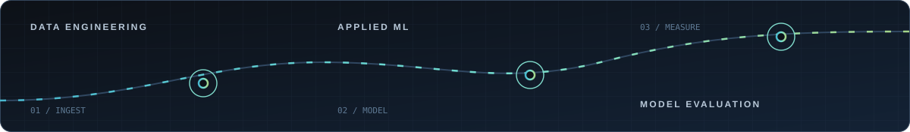
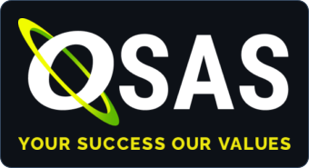

# Nguyen Viet Anh

**Data Engineer · Applied Machine Learning · Model Evaluation**  
Ho Chi Minh City, Vietnam · B.Sc. Computer Science, HCMUT

I work as a Data Engineer at OSAS Joint Stock Company via AI-MED, building Oracle warehouse loads and Python applications. I also test how models perform on future transactions and on people outside their training data. My public projects include runnable notebooks, source code, and the evidence behind their results.

[Portfolio](https://vietanh1803.github.io/VietAnhPortfolio/) · [CV](https://vietanh1803.github.io/VietAnhPortfolio/Nguyen-Viet-Anh-CV.pdf) · [Kaggle](https://www.kaggle.com/vanh1803) · [Certificates](https://vietanh1803.github.io/certificates-hub/) · [LinkedIn](https://www.linkedin.com/in/nguyenvietanh180304/)

## Selected work

- **[LeakageLab — Temporal Risk Benchmark](https://github.com/VietAnh1803/LeakageLab)** — An independent, AI-assisted benchmark built around 50,000 synthetic transactions, delayed labels, and time-based evaluation. Logistic regression was selected on validation; author-side AP on 10,051 future transactions was 0.193. All 18 tests passed locally and on Kaggle. The public notebook reproduces model selection and writes predictions on CPU with Internet off. [Run on Kaggle](https://www.kaggle.com/code/vanh1803/leakagelab-public-reference-solver) · [Input dataset](https://www.kaggle.com/datasets/vanh1803/leakagelab-public-solver-input)
-  **[HealthMate](https://github.com/Brookvita3/HealthMate)** — Graduation thesis with a team of three. I designed the Flutter UI and contributed to stress-model, readiness-model, and prescription-OCR evaluation. Our stress experiment used leave-one-subject-out validation on 15 WESAD participants (869 labeled windows), reaching 93.8% mean accuracy and 92.8% macro-F1. The current evaluation used full-record per-subject normalization; resting-only calibration remains to be tested. [Flutter app](https://github.com/Btbach25/HealthMate_FE) · [Project summary](https://vietanh1803.github.io/VietAnhPortfolio/#work)
-  **[Adult Income — Classical ML and PyTorch](https://github.com/VietAnh1803/HCMUT_ML_AdultCensusIncome_Pipeline)** — A post-coursework extension with validation-only selection and a separate official test of 16,249 records. LightGBM reached 86.73% accuracy; the PyTorch MLP reached 84.09%, with three-seed accuracy of 84.09–84.50%. Both improved over legacy-recipe controls under the same protocol. [Notebook](https://github.com/VietAnh1803/HCMUT_ML_AdultCensusIncome_Pipeline/blob/main/notebooks/adult_income_improved.ipynb) · [Measured comparison](https://github.com/VietAnh1803/HCMUT_ML_AdultCensusIncome_Pipeline/blob/main/reports/IMPROVEMENT_REPORT.md)
-  **[Vietnam Stock Data Pipeline](https://github.com/VietAnh1803/Big-data-vnstock-pipeline)** — Personal project collecting VNStock quotes through kafka-python and Kafka, processing micro-batches with PySpark Structured Streaming, and writing through JDBC to PostgreSQL/TimescaleDB. Incremental sync with the Snowflake Python Connector and a persisted watermark feeds Bronze → Silver → DW layers, dimension tables, and minute-level OHLCV facts; SQL MERGE and Snowflake Streams & Tasks support incremental modeling. Streamlit/Plotly dashboards run alongside Docker Compose services, Nginx, ZooKeeper, Kafka UI, Spark UI/History Server, and pgAdmin, with Linux/systemd startup and Bash freshness checks. [System design](https://github.com/VietAnh1803/Big-data-vnstock-pipeline/blob/main/DOCS/SYSTEM_DESIGN.md)
-  **[AI Content Impact Analysis](https://github.com/VietAnh1803/Data-Visualization-AI-Impact)** — Reproducible exploratory analysis and bilingual dashboard. The 200-row dataset has no documented sampling method, so the report avoids causal claims.

At OSAS Joint Stock Company via AI-MED, I work on Oracle warehouse loads and a Vietnamese financial-statement assistant using SQL and vector retrieval. These are company projects, so their source code is not included here. More detail is available in my [portfolio](https://vietanh1803.github.io/VietAnhPortfolio/).

## Tools I use

  
  
  
  
  
  
  
  

- **Data & ML:** Python, SQL, NumPy, Pandas, scikit-learn, CatBoost, PyTorch, LightGBM, model evaluation
- **Databases & ETL:** Oracle, PL/SQL, ODI, GoldenGate, PostgreSQL/TimescaleDB, pgvector, Snowflake (Streams & Tasks), incremental loading, Bronze/Silver/DW and dimension/fact modeling
- **Streaming & connectors:** VNStock, Kafka, kafka-python, Spark/PySpark Structured Streaming, JDBC, psycopg2, Snowflake Python Connector
- **Applications & BI:** FastAPI, Flutter/Dart, Ollama, OpenSearch, OpenCV, PaddleOCR, Streamlit, Plotly
- **Delivery & operations:** Docker, Docker Compose, Nginx, ZooKeeper, Linux, Bash, systemd, Git, GitHub Actions
- **Monitoring & administration:** Kafka UI, Spark UI/History Server, pgAdmin

## Connect

[Portfolio](https://vietanh1803.github.io/VietAnhPortfolio/) · [Kaggle](https://www.kaggle.com/vanh1803) · [Certificates](https://vietanh1803.github.io/certificates-hub/) · [LinkedIn](https://www.linkedin.com/in/nguyenvietanh180304/)
